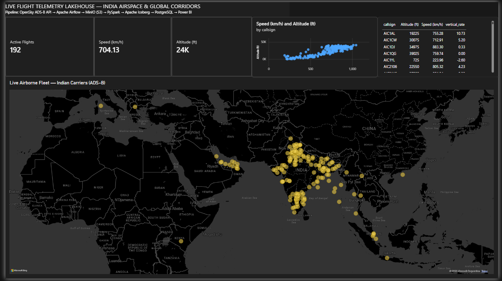
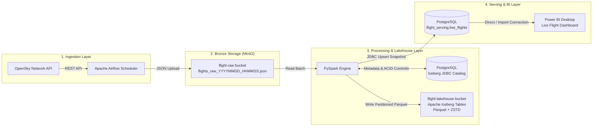

# ✈️ Live Flight Telemetry Lakehouse & Real-Time Analytics Pipeline


An enterprise-grade, end-to-end Data Lakehouse pipeline designed to ingest, process, catalog, and visualize live global flight telemetry in real time. The stack integrates **OpenSky Network API**, **Apache Airflow**, **MinIO (S3)**, **Apache Iceberg**, **Apache Spark / PySpark**, **PostgreSQL**, and **Microsoft Power BI**.

---

## 📑 Table of Contents
- [Overview](#-overview)
- [Dashboard Preview](#-dashboard-preview)
- [Architecture & Data Flow](#-architecture--data-flow)
- [Technology Stack](#-technology-stack)
- [Project Directory Structure](#-project-directory-structure)
- [Services & Credential Matrix](#-services--credential-matrix)
- [Getting Started](#-getting-started)
- [Pipeline Operations & Airflow DAG](#-pipeline-operations--airflow-dag)
- [Lakehouse Architecture (Apache Iceberg)](#-lakehouse-architecture-apache-iceberg)
- [Power BI Dashboard Setup](#-power-bi-dashboard-setup)
- [Troubleshooting & Useful Commands](#-troubleshooting--useful-commands)

---

## 🌐 Overview

This project implements a modern medallion lakehouse architecture for high-velocity aviation telemetry:
1. **Raw Bronze Ingestion**: Fetches live global aircraft transponder states (ICAO 24-bit addresses, callsigns, positions, velocities, altitudes) from the OpenSky Network REST API every 5 minutes and lands micro-batches as immutable JSON objects in **MinIO S3 storage**.
2. **Lakehouse Storage (Apache Iceberg)**: PySpark reads raw micro-batches, validates geographical coordinates, infers typed schemas, and commits the records to an **Apache Iceberg** table partitioned by `origin_country` and `flight_date` using Zstandard-compressed Parquet files.
3. **High-Speed Serving Layer**: Concurrently snapshots the current live state into a **PostgreSQL** serving database (`flight_serving.live_flights`).
4. **BI & Analytics**: Direct reporting and live tracking in **Power BI Desktop**, enabling interactive spatial geospatial maps, speed/altitude gauges, and country-level filtering (e.g., active flights in India).

---

## 📊 Dashboard Preview



*Live ADS-B transponder positions of Indian-registered airborne aircraft tracked across domestic trunk routes, the Persian Gulf, Southeast Asia, and Europe, alongside climb-to-cruise velocity/altitude telemetry.*

---

## 🏛️ Architecture & Data Flow



---

## 🛠️ Technology Stack

| Layer | Technology | Version | Purpose |
| :--- | :--- | :--- | :--- |
| **Orchestration** | [Apache Airflow](https://airflow.apache.org/) | `2.9.3` | Scheduled DAG orchestration, retry management, alerting |
| **Object Storage** | [MinIO](https://min.io/) | `Latest (Chainguard)` | S3-compatible Bronze landing bucket & Iceberg warehouse storage |
| **Table Format** | [Apache Iceberg](https://iceberg.apache.org/) | `1.5.2` | ACID transactions, schema evolution, partition pruning, time-travel |
| **Compute Engine** | [Apache Spark / PySpark](https://spark.apache.org/) | `3.5.1` | Distributed telemetry batch validation, cleaning, and catalog commits |
| **Catalog & Serving** | [PostgreSQL](https://www.postgresql.org/) | `15-Alpine` | Airflow metadata backend, Iceberg JDBC Catalog, BI Serving Table |
| **Data Visualization** | [Microsoft Power BI](https://powerbi.microsoft.com/) | Desktop | Interactive maps, geospatial telemetry, speed & altitude metrics |
| **Containerization** | [Docker & Docker Compose](https://www.docker.com/) | v2+ | Fully isolated multi-container orchestration |

---

## 📂 Project Directory Structure

```text
flight_data/
├── .env.example                      # Template environment variables (copy to .env)
├── .gitignore                        # Git exclusion rules
├── assets/
│   └── dashboard.png                 # Power BI live flight radar preview
├── Dockerfile.airflow                # Custom Airflow image with Java 17, PySpark & S3 libs
├── docker-compose.yml                # Multi-service stack definition
├── config/
│   └── spark-defaults.conf           # Spark master/worker Iceberg and AWS S3 configurations
├── dags/
│   └── flight_data_pipeline_dag.py   # Main pipeline DAG (MinIO extract -> PySpark Iceberg)
├── scripts/
│   ├── airflow-init.sh               # Airflow migration, admin user & MinIO bucket provisioner
│   └── init-postgres.sql             # SQL script initializing airflow, catalog, and serving DBs
└── spark/
    └── apps/
        ├── ingest_flight_telemetry.py # PySpark script processing raw telemetry into Iceberg & Postgres
        └── init_iceberg_table.py      # Standalone table initializer and schema definition
```

---

## 🔑 Services & Credential Matrix

All services are orchestrated via Docker Compose and bound to standard localhost ports:

| Service | Internal Port | Host Port | Web UI / Access Endpoint | Username | Password / Secret | Database / Bucket |
| :--- | :--- | :--- | :--- | :--- | :--- | :--- |
| **Airflow Webserver** | `8080` | `8085` | [http://localhost:8085](http://localhost:8085) | `admin` | `admin` | DB: `airflow` |
| **MinIO Console** | `9001` | `9001` | [http://localhost:9001](http://localhost:9001) | `admin` | `adminpassword123` | Console UI |
| **MinIO S3 API** | `9000` | `9000` | [http://localhost:9000](http://localhost:9000) | `admin` | `adminpassword123` | Buckets: `flight-raw`, `flight-lakehouse` |
| **PostgreSQL** | `5432` | `5433` | `localhost:5433` | `postgres` | `postgres` | `flight_serving`, `iceberg_catalog`, `airflow` |
| **Spark Master UI** | `8080` | `8082` | [http://localhost:8082](http://localhost:8082) | *None* | *None* | Cluster status |
| **Spark Master Port**| `7077` | `7077` | `spark://localhost:7077` | *None* | *None* | Cluster RPC |

---

## 🚀 Getting Started

### 1. Prerequisites
- [Docker Desktop](https://www.docker.com/products/docker-desktop/) (running on Windows with WSL 2 backend).
- Memory allocation: At least **6GB to 8GB** RAM allocated to Docker.
- [Microsoft Power BI Desktop](https://powerbi.microsoft.com/desktop/) for dashboarding.

### 2. Clone and Configure
```powershell
# Clone the repository and navigate into the project directory
git clone https://github.com/Pramod-wagh/live-flight-telemetry-lakehouse.git
cd live-flight-telemetry-lakehouse

# Create your local environment file from the template
copy .env.example .env
```

### 3. Build & Launch the Services
Start Docker Desktop, then bring up the entire infrastructure:
```powershell
docker compose up -d
```

### 4. Verify Service Health
Check running containers:
```powershell
docker ps
```
Ensure all 6 containers (`flight-postgres`, `flight-minio`, `flight-spark-master`, `flight-spark-worker`, `flight-airflow-webserver`, and `flight-airflow-scheduler`) show `Up`.

---

## 🔄 Pipeline Operations & Airflow DAG

1. Open the **Airflow Web UI** at [http://localhost:8085](http://localhost:8085).
2. Log in with `admin` / `admin`.
3. Locate the DAG: **`live_flight_telemetry_pipeline`**.
4. Unpause the DAG (toggle the slider to **On**) or trigger it manually by clicking the **Play** button.

### Tasks Inside the DAG:
- **`extract_and_upload_raw_to_minio`** (PythonOperator):
  - Queries `https://opensky-network.org/api/states/all`.
  - Streams raw JSON bytes into `s3a://flight-raw/flights_raw_<timestamp>.json` and updates `latest.json`.
  - Pushes S3 URI via Airflow XCom.
- **`pyspark_iceberg_and_postgres_sync`** (BashOperator):
  - Invokes `ingest_flight_telemetry.py` with Spark runtime dependencies.
  - Cleans coordinates, parses UTC timestamps, and appends to the Iceberg Lakehouse.
  - Overwrites `public.live_flights` in the `flight_serving` PostgreSQL database.

---

## 🧊 Lakehouse Architecture (Apache Iceberg)

The lakehouse uses Apache Iceberg to provide ACID transactions and metadata-driven pruning.

### Table Definition
- **Identifier**: `lakehouse.flights.live_telemetry`
- **Catalog**: PostgreSQL JDBC Catalog (`jdbc:postgresql://postgres:5432/iceberg_catalog`)
- **Storage Location**: `s3://flight-lakehouse/`
- **File Format**: Parquet with `zstd` compression
- **Partitioning**: 
  - `origin_country` (Identity partition)
  - `days(flight_date)` (Time-based hidden partition)

### Schema Definition
| Field | Type | Description |
| :--- | :--- | :--- |
| `icao24` | `STRING` | Unique ICAO 24-bit aircraft address (hexadecimal) |
| `callsign` | `STRING` | 8-character callsign assigned to the flight |
| `origin_country` | `STRING` | Country where aircraft is registered |
| `time_position` | `LONG` | Epoch timestamp of last position report |
| `last_contact` | `LONG` | Epoch timestamp of last transponder ping |
| `longitude` | `DOUBLE` | WGS-84 longitude coordinate |
| `latitude` | `DOUBLE` | WGS-84 latitude coordinate |
| `baro_altitude` | `DOUBLE` | Barometric altitude in meters |
| `on_ground` | `BOOLEAN` | Flight status (`true` = landed/taxiing, `false` = airborne) |
| `velocity` | `DOUBLE` | Ground speed in meters/second |
| `true_track` | `DOUBLE` | True track heading clockwise from north (degrees) |
| `vertical_rate` | `DOUBLE` | Climb/descent rate in meters/second |
| `geo_altitude` | `DOUBLE` | Geometric altitude in meters |
| `squawk` | `STRING` | 4-digit transponder squawk code |
| `spi` | `BOOLEAN` | Special Purpose Indicator |
| `position_source`| `INT` | 0 = ADS-B, 1 = ASTERIX, 2 = MLAT |
| `event_timestamp`| `TIMESTAMP` | Converted UTC timestamp |
| `flight_date` | `DATE` | Extracted UTC flight date |

---

## 📊 Power BI Dashboard Setup

### 1. Connect Power BI to PostgreSQL
1. Open **Power BI Desktop**.
2. Click **Get Data** → **PostgreSQL database**.
3. Configure the connection dialog:
   - **Server**: `localhost:5433` *(or `127.0.0.1:5433`)*
   - **Database**: `flight_serving`
   - **Data Connectivity Mode**: `Import` (or `DirectQuery` for real-time auto-refresh)
4. In the authentication prompt, select the **Database** tab on the left:
   - **User name**: `postgres`
   - **Password**: `postgres`
5. Select the **`public.live_flights`** table and click **Load**.

### 2. Configure Geospatial Columns
1. In the **Table View** (left pane) or the **Data** pane (right pane), select the **`latitude`** column.
2. In the top ribbon under **Column tools**, change **Data category** to **Latitude**.
3. Select the **`longitude`** column and change **Data category** to **Longitude**.

### 3. Filter for Airborne Flights in India
In the **Filters** pane on the right, add filters to **Filters on this page**:
- **`origin_country`**: Select `India`.
- **`on_ground`**: Select `False` *(excludes parked/grounded aircraft)*.

### 4. Recommended Visualizations
- **Live Flight Map** (Map / Azure Map visual):
  - Latitude: `latitude` (Don't summarize)
  - Longitude: `longitude` (Don't summarize)
  - Tooltips: `callsign`, `velocity`, `baro_altitude`, `origin_country`
- **Active Flights Metric** (Card visual):
  - Field: `callsign` (Aggregation: **Count (Distinct)**)
- **Fleet Table** (Table visual):
  - Columns: `callsign`, `origin_country`, `velocity`, `baro_altitude`, `event_timestamp`

### 5. Custom Aviation Measures (DAX)
Add these measures to display metrics in standard aviation units *(note: Power BI imports `public.live_flights` as `'public live_flights'`)*:
```dax
Speed (km/h) = AVERAGE('public live_flights'[velocity]) * 3.6
```
```dax
Altitude (ft) = AVERAGE('public live_flights'[baro_altitude]) * 3.28084
```

---

## 🛠️ Troubleshooting & Useful Commands

### 1. "No such host is known" Error in Power BI
* **Cause**: Power BI runs on your Windows host and cannot resolve internal Docker container names like `postgres`.
* **Fix**: Use `localhost:5433` or `127.0.0.1:5433`.

### 2. Docker Daemon Not Running
If you get `failed to connect to the docker API at npipe:////./pipe/dockerDesktopLinuxEngine`:
```powershell
Start-Process "C:\Program Files\Docker\Docker\Docker Desktop.exe"
```
Wait for the Docker icon to stabilize, then rerun `docker compose up -d`.

### 3. Check Live Database Records via CLI
```powershell
# View total active flights in India
docker exec -it flight-postgres psql -U postgres -d flight_serving -c "SELECT count(*) FROM live_flights WHERE origin_country = 'India';"

# Preview top 5 active flights
docker exec -it flight-postgres psql -U postgres -d flight_serving -c "SELECT callsign, velocity, baro_altitude, latitude, longitude FROM live_flights WHERE origin_country = 'India' LIMIT 5;"
```

### 4. View Container Logs
```powershell
# Airflow scheduler logs
docker logs -f flight-airflow-scheduler

# PySpark / Spark master logs
docker logs -f flight-spark-master
```

### 5. Tear Down and Clean Up
```powershell
# Stop all services
docker compose down

# Stop and wipe persistent volumes (MinIO data and Postgres database)
docker compose down -v
```

---

## 📜 License
Distributed under the MIT License. OpenSky Network API usage is subject to OpenSky terms of service.
